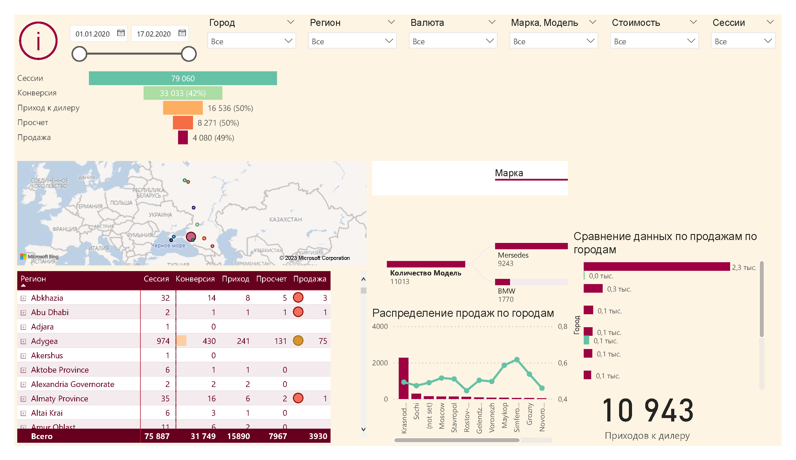
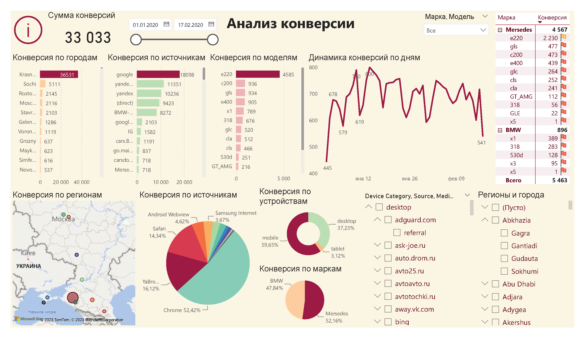
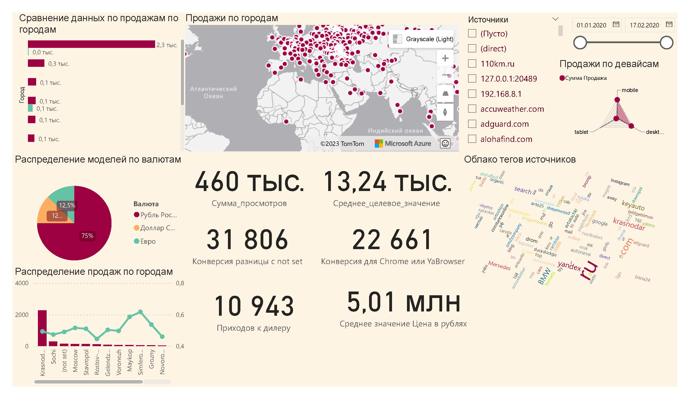

# Auto-Dealer Marketing & Sales Dashboard

Interactive Power BI dashboard for a car dealership that joins marketing
web data with CRM sales and answers one business question: which channels,
cities and models bring not just traffic and leads, but actual sales.

Period: Jan 1 – Feb 17, 2020.

## Sales funnel (end-to-end)

79,060 sessions → 33,033 conversions (42%) → 16,536 dealer visits (50%)
→ 8,271 calculations (50%) → **4,080 sales (49%)**

## Data & Model

- **Marketing data** — sessions, pageviews and goal conversions by city,
  device, browser and traffic source (Google Sheets)
- **CRM sales** — deals linked to clients
- **Reference table** — car models with price, margin and average price (RUB)
- **CBR daily FX rates** — to normalize multi-currency sales before the join
- Star-schema relationships: reference ↔ marketing ↔ CRM, with
  bidirectional cross-filtering so both sources filter each other

## Dashboard pages

**Conversion analysis**
- Conversions by city, source, model, device and brand; daily dynamics
- "(not set)" city values cleaned via DAX measure (31,806 identified conversions)
- DAX measures: pageviews sum (460k), average goal value (13.24k),
  conversions for Chrome or Yandex Browser (22,661), unique users,
  top-3 cities dealer visits

**Sales analysis**
- Sales funnel and regional drill-down table (region / city / brand) with
  alternating-row styling, conversion histogram bars, presence-of-sale flag
  and traffic-light conditional formatting
- Sales by city map, currency split of models, daily sales calendar,
  KPI cards (dealer visits 10,943, avg price 5.01M RUB), source tag cloud

## Key findings

- Full funnel converted **4,080 sales** from 79k sessions — steady ~50%
  step-to-step drop-off after the 42% conversion rate
- **Google is the top source** — 18.1k conversions (~55% of all);
  Yandex traffic arrives under two naming variants (~21.6k combined),
  flagged for source-name normalization
- Top model: **Mercedes e220** — 4.6k conversions (2.2k model-matched),
  far ahead of the next models
- Brand split is asymmetric: conversions by brand are nearly even
  (Mercedes 52.2% vs BMW 47.8%), while model-matched conversions are
  dominated by Mercedes (4,567 vs 896)
- **Mobile drives 59.7%** of conversions (desktop 37.2%, tablet 3.1%)
- **Chrome** dominates browsers (52.4%), followed by Yandex Browser (16.1%)
  and Safari (14.3%)
- Sales are concentrated: the leading city accounts for **~2.3k of 4.1k
  sales (~56%)**; currency mix 75% RUB / 12.5% USD / 12% EUR

## Stack

Power BI (Power Query, DAX), Google Sheets as data source, CBR daily FX rates

## Visual case study

The design version of this project:
[From Click to Car Sale on Behance](https://www.behance.net/annshchuga)
